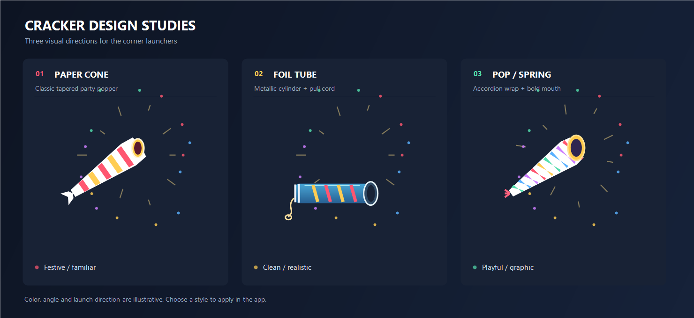

# Anti-Productivity Confetti (APC)

> **紙吹雪を舞わせ、集中力には少し休暇を。**
> 効率化の波に乗り続けるあなたへ、今度は画面に本物の波（紙吹雪）を起こします。

**Anti-Productivity Confetti (APC)** は、キー入力やクリックをきっかけに、モニターの左右下からクラッカーを鳴らすデスクトップオーバーレイです。紙吹雪は画面の外から絶えず降り、F1〜F3でクラッカーの意匠も選べます。作業を止める機能はありません。画面を眺めてしまう時間についても、保証対象外です。

- Japanese manual: [README/README.ja.md](README/README.ja.md)
- English manual: [README/README.en.md](README/README.en.md)
- Specification: [Japanese](SPECIFICATION/SPECIFICATION.ja.md) / [English](SPECIFICATION/SPECIFICATION.en.md)

## Quick start

Run `APC.exe`. Confetti falls continuously from above the screen. Press a key or click the mouse to launch curved bursts from the crackers at the bottom corners. Press **Esc** to exit.

Edit `settings.ini` beside the executable to change the rain rate and particle limits.

## Cracker design samples



Individual concepts: [Paper cone](docs/cracker-designs/01-paper-cone.png) · [Foil tube](docs/cracker-designs/02-foil-tube.png) · [Pop / spring](docs/cracker-designs/03-pop-spring.png)

## Build

Visual Studio 2022 with the Desktop development with C++ workload and Windows SDK is required.

```powershell
MSBuild APC.vcxproj /t:Rebuild /p:Configuration=Release /p:Platform=x64
```

Output: `bin\x64\Release\APC.exe`. Create a release archive and SHA-256 checksum with `powershell -ExecutionPolicy Bypass -File scripts\package.ps1`.

## License

[MIT License](LICENSE).
